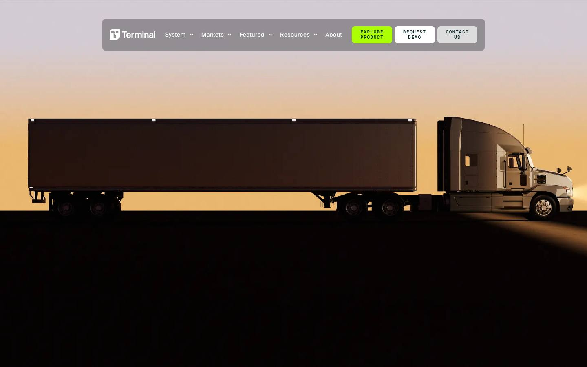
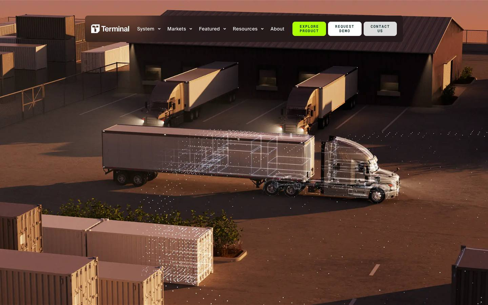
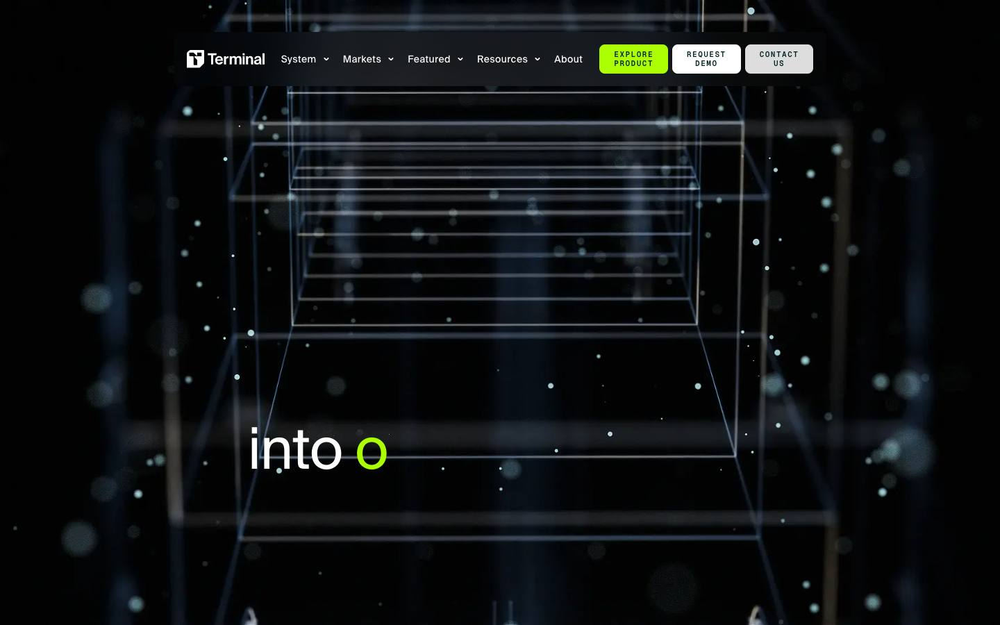
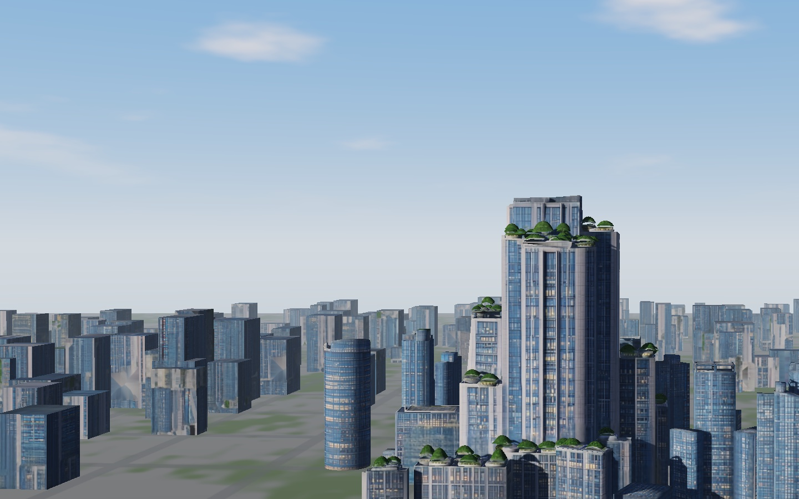
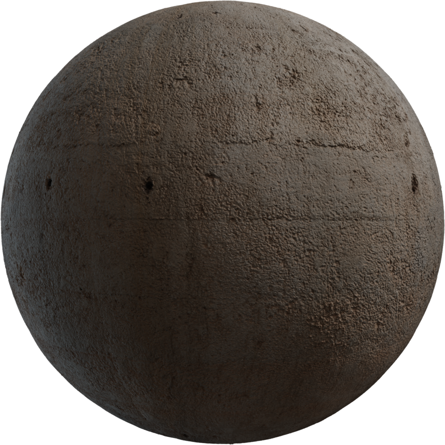
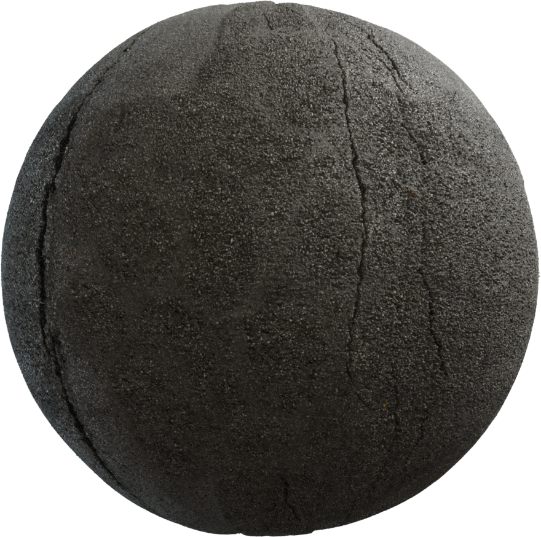
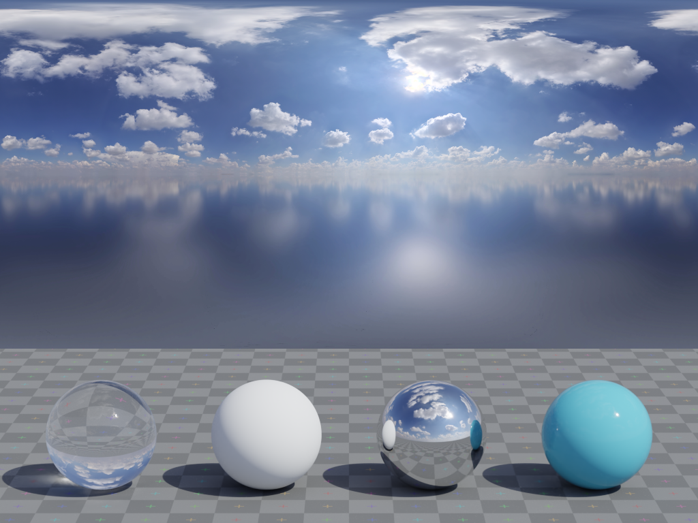

# Tamira skyline hero — architectural quality and continuity brief

Prepared 2026-11-05. **Planning artifact only. No website implementation is authorized by this document alone.** The current request is research and a detailed production prompt. Future execution requires a separate implementation request. The previous clay brief is preserved at [docs/archive/prompt-clay-hero-2026-11-05.md](docs/archive/prompt-clay-hero-2026-11-05.md); its aesthetic and raster-first recommendation do not govern this brief.

## 1. Production prompt

Improve Tamira's existing city landscape to the standard of a carefully art-directed architectural visualization. Build a believable contemporary district around the existing planted terrace tower: clear structural rhythm, recessed glazing, credible facade thickness, deliberate setbacks, natural planting, grounded streets and controlled daylight. The city must feel inhabited and engineered, not like identical textured boxes or melted generated geometry.

The argument is specific to Tamira: **the visible city depends on wiring people never see.** Establish a convincing inhabited district, move from daylight into dusk, reveal its hidden electrical network, follow one feeder into a furnished room, then reveal the three-core cable and physically extract the red core into the existing product story. Visual credibility must survive the moving camera, architectural scan and close approach, not just a single opening screenshot.

Use Terminal Industries as a benchmark for subject continuity, grounded lighting, surface separation and the transition from a solid subject to a technical representation. Use the user's architectural and industrial images for construction detail and material finish. Keep Tamira's existing typography, layouts and narrative. Do not import another site's visual identity.

### Non-negotiable boundaries

- Preserve Geist Serif headings, Instrument Sans body copy, logo, navigation, rounded frame, copy, CTA placement and all existing responsive layouts.
- Preserve the latest smaller hero title: `clamp(2.5rem, 1.52rem + 3.36vw, 5.6rem)`; do not undo the 20% reduction.
- Preserve the city → dusk → scan → underground network → tower riser → room → ceiling cable → red/blue/green bundle → physical red extraction → existing product chapters.
- Preserve chapter order, timing, reverse seeking, reduced-motion behavior and fallback handling. A visual-quality task is not permission to lengthen the story.
- Preserve all product-wire materials, copper/strands/flex/heat/flame/smoke chapters, switchboard insertion and final living room. The previously rejected red cable material must not return.
- Keep vanilla JavaScript, Vite 5.4.10, Three.js 0.170.0, GSAP 3.12.5 and the existing two WebGL contexts. No React conversion or new animation framework.
- Do not copy Terminal's truck, assets, lime palette, navigation, copy or font. Do not copy the reference architecture literally.
- No scene creation, render job, model import, material assignment or website code changes as part of this planning delivery.

## 2. Evidence and what it establishes

### Terminal Industries: observed behavior

Reference: [terminal-industries.com](https://terminal-industries.com/), inspected in an isolated muted Comet session. Captures are review references, not licensed production assets.







The captured progression starts with a readable side-on truck against a warm sky. A wider elevated yard view supplies buildings, containers, paving and shadows; scan lines and points overlap the truck before the sequence moves into a dark technical space. The environment is part of the explanation rather than an unrelated decorative background. Trailer panels, cab, tires and ground have different light responses. Contact shadows and directional reflections establish weight. The scan keeps enough recognizable silhouette to link the technical view to the physical subject.

These captures were made at 1440×900 after loading, then at successive 650px wheel increments. They are sampled states, not an exhaustive frame-by-frame measurement or proof of physical-device performance. Captures 03–05 are retained alongside them for sequence context. The screenshots also reflect the site's current load/animation state; they do not establish intended text timing.

### Terminal: shipped-code findings, distinct from visual inference

Public homepage HTML and its linked chunks were downloaded as inert text. REA analyzed the entry bundle, then a focused selection of `DXfGmXPJ.js`, `v4SaURl9.js` and `B8tolC06.js`. The focused analysis parsed three files, 11,134 text bytes, with no parse failures. Coverage remains partial: 50 inventoried files were outside that selection, with dynamic relationships unresolved. Evidence summary: [rea-evidence.json](docs/references/skyline-upgrade/rea-evidence.json).

Manual inspection of those same shipped chunks establishes:

- `VideoSequenceScroll` maps ScrollTrigger progress to a frame-sequence component.
- Desktop configuration uses `/static/frames/home/desktop/webp/hero_anim_desktop_60_{index}.webp`, count **410**.
- Mobile configuration uses `/static/frames/home/mobile/webp/hero_anim_mobile_60_{index}.webp`, count **409**.
- Sequence rendering creates a `canvas`, requests a **2D** context, and uses `drawImage` with fitted cover positioning.
- A `video-sequence.worker-B5BJOqje.js` worker receives frame requests; cleanup terminates it and clears image sources.

Public code links: [hero sequence](https://terminal-industries.com/_nuxt/DXfGmXPJ.js), [frame renderer](https://terminal-industries.com/_nuxt/v4SaURl9.js). Chunk URLs may change after deployment. REA parent evidence: `ev_82b167973c602cd98ddf0032131640605c65982d1a49a2249fed59c99aa349ec`.

**Conclusion:** the inspected homepage hero is a prerendered image sequence displayed on a 2D canvas. A canvas does not prove live WebGL. Its finish is not evidence that the same quality is cheap to produce with an arbitrary realtime model. The source DCC, render engine, topology, exact materials, lighting values and full production process are unknown. Do not invent them. Other videos elsewhere on the page do not identify the hero delivery mechanism.

### Current Tamira: verified source facts



This is the current asset's existing fallback poster, not a newly captured screenshot and not proof of the latest title size.

- `public/skyline/city.glb`: 459,884 bytes; generator metadata `Tripo`; **one mesh, one primitive, one material**, 11,233 vertex entries and 24,735 indices, or **8,245 triangles** in triangle mode.
- Runtime uses `city-2k.jpg` with a shared `MeshStandardMaterial`, roughness **0.9**, metalness **0**. That cannot independently describe polished glazing, stone, aluminum and foliage.
- `index.js` takes the first mesh, clones its geometry and applies the common material. It then disposes the imported scene. A future multi-mesh/multi-material GLB will lose its intended structure unless this loader is deliberately updated.
- `filler.js` creates instanced boxes; `cityMaterial.js` samples arbitrary atlas patches for their facade UVs. Runtime requests 360 base filler instances on desktop and 180 on coarse pointers; the generator also budgets an additional 55% low-rise instances, subject to placement limits.
- Night glazing/foliage identification is inferred from texture RGB. It is not semantic material segmentation.
- LiDAR points and edges derive from the same geometry and texture classification. Changing geometry without adapting this path can produce a noisy or broken technical reveal.
- Current city lighting uses a directional light, hemisphere fill, static shadow updates, procedural sky/fog and bloom. The PMREM room environment in the file belongs to the cable bridge; do not assume it already supplies architectural city reflections.

### Diagnosis

The low triangle count is a constraint, but adding subdivisions will not reconstruct window recesses, restore malformed terrace shapes, separate physical materials or correct random atlas sampling. The visible problems are a combination of weak source architecture, insufficient material segmentation, repeated filler forms, planting silhouettes, ground design, reflection/lighting and atmospheric presentation. Diagnose normals and UV distortion directly during production; those defects are plausible risks, not facts proven by a screenshot.

## 3. User reference images: interpretation and availability

The six supplied images were visually reviewed in the conversation. Their original attachment bytes are not exposed as local project files in this session. They are **not falsely represented by the Terminal captures or the existing skyline poster**. This document records their roles below; a portable handoff still needs the six original files saved beside this document. Do not use broken Markdown image links or substitute generated approximations.

| ID | Supplied image | Apply | Do not inherit |
| --- | --- | --- | --- |
| U1 | Current Tamira hero, blue skyline, planted tower on right | Current identity, composition and failure baseline | Repeated flat boxes, vague terrain, atlas smears or broad haze as a quality target |
| U2 | 53WEST53, upward view of diagonally braced tower | Sharp structural logic, glass/frame separation, sunlight/shadow hierarchy, architectural authority | Its camera angle across our full story, typography, navigation or exact tower design |
| U3 | “Bring your real estate vision to life”, terrace tower and skyline | Credible facade rhythm, planted setbacks, dominant tower within a believable city | Mixed headline fonts, overlapping UI, copied layout or exact building |
| U4 | CGSTANDARD.COM industrial isometric machinery | Small bevels, restrained PBR, clean assembly detail, scale, coherent soft contact shadows | Factory scene, orange accents as a new palette, people/machines as required props; retain watermark on reference |
| U5 | Night apartment tower on square diorama base | Window depth, balconies, roof equipment, lit-room variation, paving/planting/contact detail | Black void, square floating base or a permanently nocturnal hero |
| U6 | Warm-toned architectural scale model on a desk, with a digital building model on the monitor behind it | Layered floor bands, dense vertical facade fins, recessed dark glazing, stepped planted roof terraces, credible edge thickness and grounded assembly | Desk/monitor scene, display plinth, photographic shallow focus, exact building design or an automatic orange/copper recoloring of the entire city |

For the portable package, use `user-01-current-hero`, `user-02-53west53`, `user-03-terrace-tower`, `user-04-industrial-finish`, `user-05-night-apartment`, `user-06-finned-terrace-model`, retaining originals and source attribution. Record actual extensions and dimensions in a manifest when originals become available. Reference images do not grant permission to redistribute their depicted assets or use them on the website.

### U6 — architectural model finish and facade construction

The additional reference shows a physical-looking architectural model in the foreground and a digital model on a monitor behind it. Treat the foreground building as the construction/finish benchmark: closely spaced warm vertical fins wrap layered, offset floor bands; deep shadow gaps separate those bands; glazing is recessed beneath them; planted roof areas sit inside substantial parapets. The contrast between light podium, dark glazing, warm fins and greenery makes each assembly readable. The image does not establish the actual fin material, manufacturing method or renderer: wood, terracotta, coated metal and copper are distinct material choices and must not be conflated from color alone.

Apply this reference to a representative tower corner during the material-slice gate. Model fins and slab edges where they affect the silhouette, parallax or visible shadows; use simplified modules or baked normal/detail maps farther away. Keep fin spacing architecturally consistent and test for moiré/shimmer during camera motion and at phone resolution. Preserve terrace planting and visible facade depth without copying the complete building or adopting the desk photography as the hero composition. Warm accents may be explored in the material study, but the existing Tamira tower identity and page palette remain the constraints. Do not infer that this reference requires a timber-clad city or a clay aesthetic.

## 4. Art direction and architectural specification

### Subject and hierarchy

Tamira's relevant ingredients are copper house wiring, hidden building services, ordinary inhabited rooms, the planted tower, urban density, the substation, an underground feeder, the ceiling run, the white cable sheath, three colored cores and the red core becoming the product subject. Every added detail should support scale, inhabitation or this route.

The first view needs one unmistakable focal tower on the right, an irregular supporting skyline below it, calm sky behind the existing upper-left headline and readable ground behind the lower-left sentence. Preserve the current composition before exploring refinements inside the canvas. Do not move HTML to accommodate an overcrowded model.

### Geometry

1. Rebuild the focal tower as intentional modular architecture. Preserve its recognizable planted terrace/setback identity and overall screen-space placement. Author floor slabs, vertical framing, recessed glazing, parapets, terrace planters, a coherent podium, service roof and entrance. Verify that structural members meet instead of intersecting arbitrarily.
2. Use real facade depth on the focal tower and any surface approached by the camera. Use restrained bevels at visible slab/frame edges; tune to projected pixel size. Sub-pixel distant bevel geometry is wasted.
3. Create 6–10 supporting building families with different footprints, floor rhythms, rooflines and setbacks. Use instances with bounded variation; organize streets and blocks. Avoid random height/texture noise and identical spacing.
4. Treat near, middle and far city separately. Near geometry needs silhouette, bases and readable details; middle distance needs facade rhythm; far distance can use simplified masses and baked detail. Use atmospheric depth to separate real layers, not hide errors.
5. Replace chunky green blobs with limited species of believable shrubs/small trees. Match planter depth and root placement. Favor stable silhouettes and restrained leaf noise over dense alpha-card overdraw.
6. Build credible curbs, sidewalks, road junctions, planted strips and tower-ground contact. Use a few scale cues visible on the actual route. No floating bases, road-through-building intersections or unused high-detail machinery.
7. The room entry and wire path must be designed into the tower. Do not finish a facade and then push the camera through an accidental wall.

### Finish

Aim for clean, contemporary architectural realism with selective detail. Concrete/stone is warm neutral; glass reflects a cooler sky without turning the entire city saturated blue; bare metal catches narrow highlights; coated frames are quieter; planting has controlled value variation. Keep wear subtle and localized. The industrial reference demonstrates finish discipline, not a requirement for toy-like plastic.

Reject melted/smeared windows, mismatched facade scale, painted-on terraces, unrelated facade patches, mirror-blue slabs, glossy roads, luminous opaque walls, deep black unfilled day shadows and global bloom masking detail.

## 5. Material schedule and source catalog

Values below are **proposed starting ranges**, not measured reference settings. Tune them under the chosen lighting in Blender and again in the pinned Three.js runtime. Author editable Principled BSDF materials; bake unsupported procedural detail. Inspect local node sockets by type and available API, not localized node names or copied Blender-version assumptions.

| Material | Metallic / roughness starting point | Construction and runtime treatment |
| --- | --- | --- |
| Architectural concrete/stone | 0 / 0.65–0.85 | Neutral base, subtle micro-normal and restrained roughness variation; modeled joints/recesses on hero surfaces; avoid photographic baked shadows |
| Coated window frames | 0 / 0.3–0.5 | Painted metal behaves as a dielectric coating at its visible surface; model highlight-bearing edges |
| Exposed aluminum | 1 / 0.25–0.45 | Separate from coated frames; restrained brushing, coherent orientation |
| Architectural glass | 0 / 0.08–0.22, IOR around 1.5 | Reflection-driven panes, slight tint and interior depth; prioritize opaque reflection/interior proxies in realtime over hundreds of expensive transmission layers |
| Roof membrane | 0 / 0.75–0.95 | Dark neutral, parapets, drains and sparse service equipment; no flat pure-black lid |
| Asphalt | 0 / 0.8–0.95 | Correct aggregate scale, subtle seams and restrained normal; no wet mirror finish unless explicitly requested |
| Paving | 0 / 0.65–0.85 | Modular joints at plausible scale; localized dirt/AO, not dark outlines around everything |
| Planting | 0 / 0.55–0.85 | A few coherent greens, modest saturation, stable normals and correct contact; test alpha cost |
| Night interiors | emissive mask, separate geometry/material | Deterministic room clusters with plausible warm/cool variation; not one random blinking value per pixel |

Do not force every metallic pixel to a binary value when filtering a packed map, but author each actual exposed metal/dielectric surface according to what it is. Glass is not metal.

### Verified source options, not imported assets

Official pages were checked during research. Only preview PNGs were saved; **full PBR texture packs and HDRIs have not been acquired or assigned**.

| Candidate | Intended role | Decision |
| --- | --- | --- |
| [Poly Haven Concrete Wall 006](https://polyhaven.com/a/concrete_wall_006) | Concrete microstructure reference / secondary service surfaces | Its weathered, chipped finish is too rough for the primary clean facade unchanged; build a cleaner hero material or select a closer swatch before acquisition |
| [Poly Haven Asphalt 02](https://polyhaven.com/a/asphalt_02) | Road material candidate | Test aggregate at street scale; reduce cracking/wear if it competes with the tower |
| [Kloofendal 48d Partly Cloudy Pure Sky](https://polyhaven.com/a/kloofendal_48d_partly_cloudy_puresky) | Daylight reflection and lighting test environment | Align visible sky, sun and reflections; avoid two conflicting suns |
| [ambientCG](https://ambientcg.com/) | Alternate clean concrete/paving library | Search and choose exact asset IDs at swatch review; no specific unverified ID is approved here |
| Custom authored glass, frames and interior masks | Main tower surfaces | Preferred over applying a generic facade photograph to a box |







[Poly Haven's asset license](https://polyhaven.com/license) and [ambientCG's license](https://docs.ambientcg.com/license/) identify their assets as CC0. Keep an asset manifest with exact page URL, downloaded file URL, asset ID, author if listed, license, acquisition date, resolution, map conventions, physical tile size and local checksum. These license statements do not apply to Terminal's imagery or the user's third-party screenshots.

Use base color/emissive in sRGB; normal, roughness, AO and metallic maps as data. Verify OpenGL normal orientation. Pack glTF ORM correctly: occlusion R, roughness G, metallic B, with the required UV channel configuration. Avoid baking daylight highlights into base color that must relight at dusk. Bake procedural shader detail when needed; Cycles-only node graphs and volume shading are not automatic web equivalents.

## 6. Lighting, color and camera

- Establish a single coherent daylight direction with readable warm-neutral illuminated faces, cooler but detailed shade, sky reflection and stable contact shadows. Start look development without bloom or fog so errors remain visible.
- Add reflected sky/environment support to the city deliberately; match the sun direction to the environment. Keep city and cable environment ownership separate.
- Use subtle distance haze after geometry and lighting pass. Preserve existing HTML haze/layout in this scope; judge the 3D city with it both visible and temporarily disabled in a development comparison, without shipping unrelated CSS changes.
- Dusk should shift sky and illumination coherently, with window/interior activation and restrained practical lights. Do not fake every reflection with emission or make stone glow.
- Protect highlights and midtone separation. Record exposure, view transform and environment rotation. Blender AgX and Three.js ACES/Neutral are different transforms: compare outputs instead of expecting numeric parity.
- Preserve existing camera poses first. Tune perspective only if the hero tower's framing and room approach can remain continuous across desktop and portrait. Do not impose the 53WEST53 low angle on every beat.
- Check the whole camera corridor: wide skyline, dusk, scan, underground network, riser, room threshold and ceiling follow. Avoid clipping, camera-wall intersections, excessive near/far depth range and sudden lens changes.
- Portrait needs deliberate composition within the current layout, not a center crop of a desktop still that loses the tower or feeder.

## 7. Delivery architecture decision

| Option | Advantage | Constraint | Recommendation |
| --- | --- | --- | --- |
| Blender-authored modular GLB + existing Three.js story | Preserves live scan, route, camera, responsive seeking and cable continuity | Requires runtime material/lighting optimization; cannot assume Cycles parity | **Default for this project** |
| Prerendered opening frames + calibrated realtime handover | Closest route to offline-rendered finish | New frame delivery, decoding/memory, portrait sequence and exact handover burdens | Escalation option only if a representative realtime slice fails the quality/performance gate |
| More subdivisions / larger atlas on current merged city | Small integration effort | Does not repair architecture or material semantics | Insufficient as the primary solution |

Do not switch to Terminal's frame architecture merely because Terminal uses it. If a hybrid becomes necessary, first present the quality/performance comparison and precise handover frames for review. It must not introduce a visible match cut in the cable extraction or replace downstream product chapters. Offline renders remain useful as a look target and fallback posters regardless of final runtime choice.

## 8. Integration contracts future implementation must respect

Read [docs/SKYLINE-HERO.md](docs/SKYLINE-HERO.md), [docs/CURRENT-CONTEXT.md](docs/CURRENT-CONTEXT.md), [docs/DESIGN-SYSTEM.md](docs/DESIGN-SYSTEM.md), the active source and `git status` first. Some historical prose, including branch/delivery statements in current-context documentation, is stale; current Git and active imports establish runtime facts. This brief was prepared on `bishwa-wire-v2`, with existing uncommitted title/CSS documentation changes to preserve.

| File | Required future treatment |
| --- | --- |
| `src/story/skyline/index.js` | Traverse intended meshes/materials, retain material semantics, build city environment, preserve loading/fallback/lifecycle; do not keep the first-mesh-only assumption |
| `layout.js` | Single source for footprints, hero/cut bounds, floors, riser, substation, feeder and entry; migrate all dependent anchors together |
| `cityMaterial.js` | Preserve scan uniforms while supporting material classes and explicit masks; replace RGB guesses for window/foliage identity |
| `filler.js` | Replace random atlas patches with a coherent modular kit and shared/instanced geometry |
| `lidar.js` | Build clean architectural scan proxies; exclude foliage and micro-bevel noise semantically rather than by RGB alone |
| `ground.js`, `atmosphere.js` | Coordinate street layout, light/sky/fog and network visibility |
| `rig.js`, `building.js`, `room.js`, `wiring.js` | Keep room/world alignment and smooth feeder-to-ceiling continuity |
| `cable-assembly.js`, `scene.js`, `timeline.js` | Protect current core extraction and product handover; avoid unrelated edits |

World contract: current source model is scaled by **400**, runtime is **Y-up**, and the tower front is **+X**. Existing hero bounds are min `[33,-2,-30]`, max `[97,216,52]`; floors start at `50.4`, height `3.6`, count `34`. Riser is `[79,31.4]` in XZ; selected room uses floor `19`, feed X `86.5`, entry Z `35.3`. These are current alignment constraints, not instructions to author a 216-meter mesh and multiply it by 400 again. Prefer an explicit asset-to-world transform and named empties/metadata for anchors. Verify transformed world positions before touching camera paths.

Build a facade section or removable/open region aligned to the room reveal. Architectural frame/scan geometry and the wiring route must share coordinates. Do not independently eyeball them. Keep scan-only proxies separate from detailed beauty geometry to prevent edge extraction from exploding into every bevel triangle.

## 9. Required skills and when to use them

Resolve installed paths before execution. Read the actual SKILL.md once per skill. Skills guide workflow; they do not authorize broader scope or override this brief's preserved UI.

| Skill | Role |
| --- | --- |
| `reverse-engineer-anything` — `~/.agents/skills/reverse-engineer-anything/SKILL.md` | Evidence-based investigation of reference runtime/shipped artifacts; mark unknowns and partial coverage |
| `design-taste-frontend` — `~/.codex/skills/taste-skill/SKILL.md` | Subject-specific art direction, image inventory, browser comparison and visual critique; keep current fonts/layout rather than draw a new site identity |
| `blender-mcp` / backend guidance in `text-to-blender/references/mcp-backends.md` | Inspect actual Blender backend/version/scene; small bounded operations; preserve user's open work |
| `blender-pro-workflow` | Blockout → camera → lighting → forms → materials → detail → export, with review gates |
| `blender-cameras` | Match lens, world transforms, desktop/portrait framing and room approach |
| `blender-materials` | Editable PBR material classes and swatch validation |
| `blender-lighting` | Architectural daylight, environment, dusk and contact shadows |
| `blender-uv-texturing` | Texel density, bake maps, UVs, normals and supported texture delivery |
| `blender-rendering` | Reference stills and fallback renders, explicit color management and output settings |
| `blender-export` and `blender-web-pipeline` | glTF export, LODs, texture/geometry compression and runtime parity checks |
| `gsap-scrolltrigger` and `web-animation-design` | Only if future integration changes motion: deterministic scroll state, reverse seeking and reduced motion |
| `fixing-motion-performance` | Only when profiling identifies actual frame-time or lifecycle problems |

Research used REA, design-taste-frontend, Blender materials/lighting/web-pipeline guidance and backend selection guidance. The live Blender addon was unreachable during this research; no scene/material inspection or creation succeeded. Do not claim this brief includes a Blender render or tested material assignment. Future implementation must begin with a fresh read-only connection check and identify the intended scene. No app-closing or render-farm actions are authorized here.

## 10. Staged execution plan for a future implementation request

### A. Baseline and contracts

Capture current day, dusk, scan, feeder, room and cable states at desktop/tablet/phone. Record asset bytes, visible triangle/draw-call counts, texture allocations, frame-time distributions and device/browser details. Export current camera/anchor metadata. Keep a clear asset rollback path; do not overwrite source or delete old media prematurely.

### B. Blockout and camera validation

Build only tower massing, floor rhythm, surrounding block hierarchy and ground. Compare screenshots inside the unchanged UI at 1440×900, 1920×1080, 768×1024 and 390×844. Check the entire approach corridor and room location. **Gate:** tower identity, empty text regions and story route work before detailed materials.

### C. Representative material slice

Finish one visible tower corner containing facade, glass, terrace, plant, podium/ground contact and one lit-room module. Produce daylight and dusk stills, then export that slice to the actual Three.js 0.170.0 runtime in an isolated development view. **Gate:** structural depth and surface distinction survive web lighting without excessive transmission, bloom or texture memory. Resolve offline/runtime differences before scaling to the city.

### D. Full kit and scan

Expand approved modules into a varied district. Build middle/far LODs and semantic metadata. Verify no obvious repeating atlas patches. Author lightweight scan proxies and calibrated point densities. **Gate:** one structure remains recognizably the same across solid, dusk and scan states; wire routes align.

### E. Controlled integration

Update loader/material handling and coordinated anchors. Keep chapter timings and all downstream behavior. Rebuild fallback posters from the accepted camera and art direction. Verify poster-to-live alignment and graceful load failures. Do not load full source-resolution maps or offline frames merely to make a desktop screenshot pass.

### F. Validation and handoff

Run production build, existing skyline and finale checks, then inspect visual captures. Profile on real mobile hardware before declaring performance complete. Deliver editable source, scripts, maps, GLB, anchor metadata, licenses, before/after captures and a concise report distinguishing automated checks from visual judgment and untested risks.

## 11. Proposed budgets and quality gates

These are initial project targets, **not measured outcomes or universal limits**. Revise from the representative slice using actual hardware. Count the whole opening, including filler, vegetation, scan, shadows and postprocessing; asset counts alone are misleading.

- Aim for 100k–200k visible triangles desktop and 40k–80k mobile across the city, with detail concentrated on the focal tower and approached surfaces. This is permission to spend geometry where it reads, not a requirement to fill a quota.
- Aim for at most 80 city beauty draw calls desktop / 50 mobile before shadow/scan/postprocessing overhead; report total render calls too. Batch by compatible material, not by flattening all physical surfaces into one shader.
- Start with 1–2K shared material maps and a dedicated hero set where justified. Use 4K only when a camera-distance comparison demonstrates a visible need. Track decoded GPU bytes and mip chains; compressed download size does not equal GPU memory.
- Aim for an initial city asset payload below 6MB and city texture GPU allocation below 64MiB on mobile. Split optional detail from first paint if needed; measure network/decoder cost.
- Target p95 frame time ≤16.7ms on the agreed desktop and ≤33.3ms on the agreed midrange phone, measured during actual scroll/scan/approach. Browser emulation is not a physical-device benchmark.
- Avoid a quality cliff between devices: reduce far density, texture size, shadows, transmission and effects before destroying the hero tower's silhouette.

Reject a candidate even if budgets pass when the architecture still looks melted, the tower floats, glass and stone respond identically, floor grids fight, plants intersect parapets, the room is misaligned, haze hides defects, scan continuity breaks, or portrait framing loses the subject.

## 12. Regression and visual review checklist

Future commands (not run for this documentation-only delivery):

```sh
npm run build
CHROME_PATH=/Applications/Comet.app/Contents/MacOS/Comet node scripts/verify-skyline.mjs
CHROME_PATH=/Applications/Comet.app/Contents/MacOS/Comet node scripts/verify-room-finale.mjs
```

Use muted Comet, isolate sessions and close only owned browser processes. Existing `?at=segment:progress` / `window.__tamira.seek()` development helpers support repeatable visual comparisons. Review `day:0`, intermediate/end `rise`, `wireOn:0.9`, `extend:0.95`, `run:0.98`, `approach:0.5`, `bundle:0.8`, `drain:0.35`, `drain:1`, `wireIn:0.5` and `copper:0.55`, plus reverse traversal and load/reduced-motion paths.

Confirm unchanged font families/title sizing/layout; stable tower-to-room route; architectural scan alignment; readable feeders; bounded labels; blue/green remaining stationary during red extraction; continuous red identity within extraction; matched product handover; unchanged finale red/black/green insertion, board visibility and original final room lighting. Check first paint, load failure, resize, aspect changes, repeated enter/leave and cleanup without texture/composer leaks.

Automated diagnostics do not certify architectural quality. Compare equal-size crops of tower corner, terrace planting, facade, street contact, dusk windows and scan silhouette against baseline and references. Judge at actual display size before zooming. Record one concrete reason for every accepted quality improvement; “premium” alone is not evidence.

## 13. Deliverables and completion definition

The present delivery is this prompt, the archived prior brief, Terminal captures, source/evidence notes and material previews. Website source remains unchanged by this task. Original U1–U6 attachment files still need to be added for a fully portable reference pack; their analysis is included above.

A future production delivery should include:

1. Editable `art/blender/skyline/` source scene with organized architecture/material/light/camera collections, reproducible build/export scripts and version information.
2. Material source/license/checksum manifest, reusable authored material library and baked web maps with physical scale/color-space metadata.
3. Optimized city asset(s), LOD/instance metadata, semantic material/scan tags and named anchor/camera data.
4. Desktop and portrait fallback posters matching the accepted live view.
5. Controlled runtime integration preserving all stated UI/story contracts.
6. Before/after evidence at required aspect ratios, build/regression results, measured performance and explicit unresolved limitations.

No commit, push, deployment, broad redesign or live Blender mutation is part of the current request.
